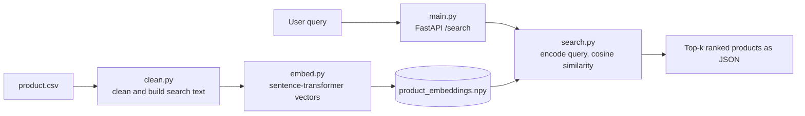

# Home Goods Semantic Search

A semantic search API for e-commerce products. It understands what a shopper
means, not just the exact words they type.

### Architecture

## What it does
- Cleans and combines product text (name, class, category, description, features)
- Turns 42,994 products into vectors with a sentence-transformer model
- Returns the products closest in meaning to a query, through a FastAPI endpoint

## Tech stack
Python, pandas, sentence-transformers (all-MiniLM-L6-v2), NumPy, FastAPI, pytest

## How it works
1. `clean.py` loads the data and builds one searchable text per product
2. `embed.py` encodes every product and saves the vectors
3. `search.py` encodes a query and ranks products by cosine similarity
4. `main.py` exposes the search as `GET /search?q=...`

## Evaluation
Tested on 480 queries from Wayfair's public WANDS dataset (233,448 human-labelled
query-product pairs), using precision@5.

| Search text | Exact only | Exact + Partial |
|---|---|---|
| Full text (name, class, category, description, features) | 0.372 | 0.807 |
| Short text (name, class, category) | 0.361 | 0.793 |

Products with no human label count as wrong, so these scores are conservative.
The full text performed better, so it is used for search.

## Known limitations
- Some modifiers are ignored. For example, "kids desk lamp" returns desk lamps
  that are not kids-specific.
- Uses a small general-purpose model with no fine-tuning.

## Run it
1. Install dependencies: `pip install pandas sentence-transformers fastapi uvicorn pytest`
2. Download the WANDS dataset files (product.csv, query.csv, label.csv) into `data/`
3. Create embeddings: `python app/embed.py`
4. Start the API: `python -m uvicorn app.main:app --app-dir app`
5. Open `http://127.0.0.1:8000/docs`
6. Run tests: `python -m pytest`

## Dataset
WANDS (Wayfair ANnotation DataSet), released publicly by Wayfair. Not included
in this repo. See the dataset's own license and README.